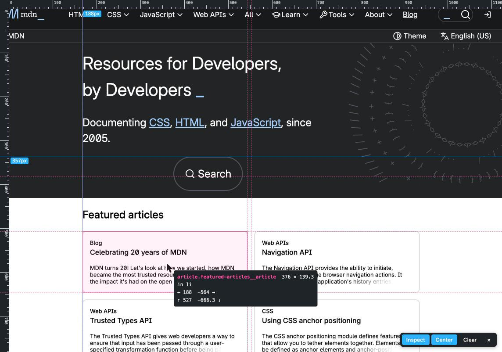

# Pixel Guides

A browser extension for Firefox and Chrome that puts rulers, draggable guide
lines, center lines and an element inspector on top of any web page, so you
can check whether elements line up, are evenly spaced and are centered.

Click the toolbar button (or press `Alt+Shift+G`) to show the overlay on the
current tab. Click it again, or the `×` in the panel, to hide it.



## Features

- **Rulers** along the top and left edge, in page pixels, that follow the
  scroll position.
- **Guides.** Drag down from the top ruler for a horizontal guide, drag right
  from the left ruler for a vertical one. Guides stick to the page content and
  scroll with it. Each guide shows its position in px.
  - Drag a guide to move it. While dragging it snaps to the edges and center of
    the element under the pointer (hold `Shift` to disable snapping) and shows
    the distance to the neighbouring guides, which makes equal spacing easy to
    verify.
  - The last guide you created, dragged or clicked is highlighted. Arrow keys
    nudge it by 1px, `Shift`+arrow by 10px, `Delete` removes it and `Esc`
    deselects it.
  - Drag a guide back onto a ruler, or double-click it, to remove it.
  - Guides are remembered per page for the browser tab's lifetime, so they
    survive a reload while you tweak CSS.
- **Center lines** through the middle of the viewport, to see at a glance
  whether the layout is centered.
- **Grid overlay** of 4, 8, 10, 12, 16 or 24px, anchored to the top left of
  the page, with a stronger line every fourth cell.
- **Inspect mode.** Hover any element to see its box, its size and its
  distance to each edge of its container. Equal left/right or top/bottom gaps
  are marked `centered`. Dashed lines extend the element's edges across the
  whole viewport so you can compare them with other elements. Click an element
  to add guides at its four edges, `Shift`+click to add guides through its
  center. `Esc` leaves inspect mode.
- Runs only when you turn it on, only on the current tab (`activeTab`). No
  host permissions, no network requests, no tracking.

## Install

### Firefox, from a release (recommended)

1. Download the latest `.xpi` from the
   [Releases](https://github.com/PauloSankovic/pixel-guides/releases/latest) page.
2. Open the downloaded file in Firefox (drag it into a Firefox window or open it
   via `File > Open File`).
3. Confirm the "Add" prompt.

The file is signed by Mozilla through the self-distribution channel, so it
installs in regular Firefox and survives restarts.

### Firefox, temporary from source

Useful for trying it out or for development. The extension is removed when
Firefox restarts.

1. Clone this repository.
2. Open `about:debugging#/runtime/this-firefox` in Firefox.
3. Click "Load Temporary Add-on..." and select the `manifest.json` file.

Requires Firefox 140 or newer.

### Chrome, from source

Chrome only installs packaged extensions through the Chrome Web Store, so
install it unpacked from a clone. Unlike Firefox, this persists across
restarts.

1. Clone this repository.
2. Open `chrome://extensions`, enable "Developer mode" (top right).
3. Click "Load unpacked" and select the repository folder.

Chrome may show a warning about the unrecognized `browser_specific_settings`
and `background.scripts` manifest keys. They are Firefox-only and can be
ignored.

## Development

```sh
npx web-ext lint
npx web-ext run --start-url https://developer.mozilla.org/en-US/
npx web-ext build
```

`web-ext run` launches a separate Firefox profile with the extension loaded and
reloads it whenever a file changes.

The whole extension is `background.js` (injects the content script when the
toolbar button is clicked) and `content.js` (the overlay, rendered in a shadow
root so page styles cannot leak in or out).

## Releasing

Releases are built by GitHub Actions. Bump `version` in `manifest.json`, commit,
then push a matching tag:

```sh
git tag v1.0.0
git push origin main v1.0.0
```

The workflow lints the extension, signs it through Mozilla's self-distribution
channel and attaches the signed `.xpi` to a new GitHub release. It needs the
`AMO_JWT_ISSUER` and `AMO_JWT_SECRET` repository secrets, created from
https://addons.mozilla.org/developers/addon/api/key/.

## License

[MIT](LICENSE)
